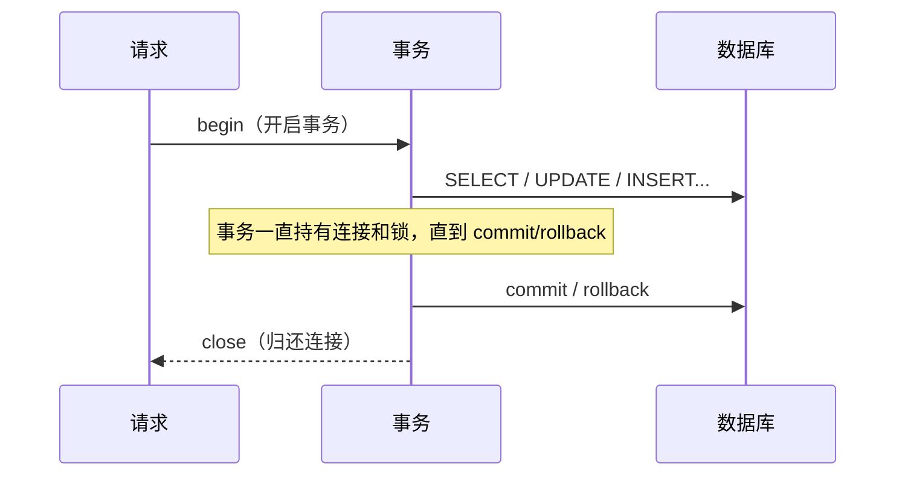
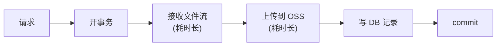
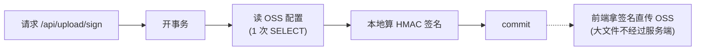

# 第 16 课：长事务和短事务

> 学习目标：理解数据库事务的边界，学会识别「长事务」并把它拆成「短事务」。

## 一、这堂课在讲什么

一句话：**一个请求对应一个数据库事务，事务越短越好；耗时的非数据库操作（如文件上传、第三方 API）不应该被包在事务里。**

本课通过「文件上传签名」这个功能来演示短事务的设计，并留了一道思考题：`update_sku` 有没有需要改动的点。

## 二、核心概念：事务的生命周期

看 `app/core/database.py` 里的 `get_db`，本课已经把它改成「显式展开」的写法：

```python
async def get_db() -> AsyncGenerator[AsyncSession]:
    session = get_session_factory()()   # 1. 创建 session（占用一条连接）
    session.begin()                     # 2. 开启事务
    try:
        yield session                   # 3. 业务逻辑在此执行
    except:                             # 4a. 出错 → 回滚并继续抛出
        await session.rollback()
        raise
    else:
        await session.commit()          # 4b. 正常 → 提交
    finally:
        await session.close()           # 5. 关闭 session，归还连接
```

请在心里记住这 5 步：**拿连接 → 开始事务 → 干活 → 提交/回滚 → 还连接**。

> ⚠️ 一个重要辨析：它和下面这种「一行简写」**默认行为相同**（都是整个请求一个事务），但**并不完全等价**——
>
> ```python
> async def get_db():
>     async with get_session_factory().begin() as session:
>         yield session
> ```
>
> `async with begin()` 把 `commit / rollback / close` 都锁死在上下文管理器里。如果你在 service 里想**主动提前 `close()` 会话、提前 `commit()` 来缩短事务**，上下文退出时还会再操作这个 session，会出问题。而显式写法把这三步的控制权交到你手上，让你可以在业务层主动切分事务边界——**这正是「短事务」落地的核心**。



## 三、长事务 vs 短事务

### 什么是「长事务」

事务从 `begin` 到 `commit` 之间**夹带了非数据库的耗时操作**，例如：

- 在事务里调用第三方 API（上传 OSS、发短信、调支付）
- 在事务里做 CPU 密集计算
- 在事务里等待（拿锁、排队）

### 长事务的危害

1. **占住连接**：连接池大小有限（本项目 `pool_size=10`），一个长事务占一条连接，并发稍高就会把连接耗尽，其他请求干等。
2. **持有锁**：写操作会持有行锁/表锁，长事务让锁迟迟不释放，阻塞别人甚至死锁。
3. **回滚代价大**：事务越长，一旦失败要回滚的数据越多。

### 短事务原则

- 事务只包住**必要的数据库操作**
- 耗时 IO / 计算放到事务外
- 减少事务内的数据库往返次数

## 四、正面案例：上传签名（短事务设计）

传统「服务端中转上传」是典型长事务反模式：



本课改成「签发签名、前端直传 OSS」，服务端事务变得极短：



迁移后的代码在：

- `app/service/upload_service.py` —— `generate_upload_sign`：读配置 → 校验类型 → 生成签名
- `app/api/upload.py` —— `POST /api/upload/sign`
- `app/schemas/upload.py` —— 请求/响应模型

关键点：**大文件上传发生在客户端与 OSS 之间，完全不占用服务端的数据库连接和事务**，这正是「把耗时操作移出事务」的经典做法。

## 五、思考题：`update_sku` 有没有需要改动的点

看 `app/service/sku_service.py` 的 `update_sku`：

```python
async def update_sku(self, sku_id: int, data: SkuUpdate) -> SkuResponse | None:
    sku = await self._get_sku_orm(sku_id)   # ① SELECT：查对象
    if sku is None:
        return None

    update_data = data.model_dump(exclude_unset=True)
    for key, value in update_data.items():
        setattr(sku, key, value)            # 内存中改字段

    try:
        await self.db.flush()               # ② UPDATE
    except sa_exc.IntegrityError as e:
        raise DatabaseException(...)
    await self.db.refresh(sku)              # ③ SELECT：重新读最新值
    return SkuResponse.model_validate(sku)
```

### 思考方向（先自己想，再看提示）

1. **这一步里总共有几次数据库往返？** ①②③ 共三次：SELECT → UPDATE → SELECT。
2. **第 ③ 步 `refresh` 是否必要？** 它是为了拿到数据库端生成的最新值（比如 `updated_at` 的 `onupdate=func.now()`）。如果你的响应不需要精确到数据库生成的 `updated_at`，这一次往返就是多余的。
3. **能不能一次往返搞定？** SQLAlchemy 的 `update(Sku).where(...).values(...).returning(Sku)` 可以单条 SQL 完成「更新 + 返回最新行」，把三次往返压成一次，事务更短。
4. **`update_stock` 是不是有同样的问题？** 对比看看。

### 提示（建议做完再看）

> 核心答案：`update_sku` 是「先查后改再刷」的写法，事务内往返偏多；可以用 `UPDATE ... RETURNING` 单语句更新，既缩短事务，又天然区分「更新成功」与「记录不存在」（404）。

## 六、建议的学习步骤

1. 读 `app/core/database.py` 的 `get_db`，画出事务的 5 步生命周期。
2. 对比 `async with session_factory().begin()` 和显式 `begin/commit/rollback/close`，说出两者为什么等价。
3. 读 `app/service/upload_service.py`，回答：为什么它的事务很短？
4. 跑测试验证迁移后的上传功能：
   - `make test-unit`
   - `make test-integration`
   - `make test-e2e`
5. 做思考题：动手改造 `update_sku`（和 `update_stock`），并用测试验证行为不变。

## 七、迁移说明（本课代码与当前项目的差异）

本课原始代码基于旧包名 `duyi_utils` 和 `app.schema`（单数），已按当前项目规范迁移：

| 教程                            | 当前项目                         |
| ------------------------------- | -------------------------------- |
| `duyi_utils`                    | `common_utils`                   |
| `app.schema`                    | `app.schemas`                    |
| `UploadService` 自管 `self._db` | 继承 `BaseService`，用 `self.db` |
| `SettingUpdateItem(key, value)` | 增加 `group_key`（按组更新）     |

测试所需 OSS 配置来自根目录 `.env.test`（用假值即可，签名是本地计算不联网）。
