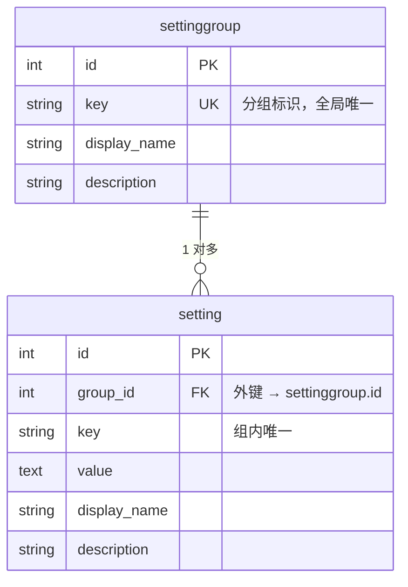

# 系统设置（Settings）功能说明

> 动态配置中心：预设配置分组与配置项，运行时通过接口读取与更新，代码即配置。

## 数据模型

采用「分组 → 配置项」两层结构：

- `settinggroup`（配置分组）：分类容器，`key` 全局唯一。
- `setting`（配置项）：具体键值对，`group_id` 外键关联分组，`(group_id, key)` 联合唯一。



拆成两张表的核心价值：`key` 只需「组内唯一」，不同分组可以有同名 key（如 `oss_endpoint` 与 `email_smtp_host` 各自独立），避免全局命名冲突。

## 预设配置（代码即配置）

预设分组与配置项定义在 `app/service/setting_service.py` 顶部的 `SETTINGS_DTO` 常量中（`SettingGroupDef` / `SettingDef`，均为 `frozen` dataclass）。

应用启动时会执行一次同步（`SettingService.initialize()`），把 `SETTINGS_DTO` 与数据库对齐：

- DTO 有、库中没有 → 创建
- 库中有、DTO 没有 → 删除
- 两边都有 → 更新 `display_name` / `description`（**不动 `value`**，保留用户已保存的值）

因此，**新增或删除预设配置，只需改 `SETTINGS_DTO`，重启后自动同步**。

## API

统一响应格式：`{"code": "0", "data": ..., "message": "success"}`。

### 获取所有设置

```http
GET /api/settings
```

返回所有分组及其配置项列表。

### 更新设置（按分组）

```http
PUT /api/settings
Content-Type: application/json

[
  {
    "group_key": "aliyun_oss",
    "key": "oss_endpoint",
    "value": "oss-cn-hangzhou.aliyuncs.com"
  },
  {
    "group_key": "aliyun_oss",
    "key": "oss_bucket_name",
    "value": "xiaofang-file-upload-test"
  }
]
```

请求体为数组，每个元素包含：

| 字段 | 说明 |
|------|------|
| `group_key` | 目标分组 key（如 `aliyun_oss`） |
| `key` | 配置项 key，**组内唯一** |
| `value` | 新值 |

更新按 `(group_key, key)` 精确匹配：不存在的分组或 key 会被忽略，返回实际更新成功的项列表。

## 部署注意事项 ⚠️

应用的 `lifespan` 在**启动时**会执行 `SettingService.initialize()`，这要求数据库表已就绪。因此部署顺序必须为：

```powershell
# 1. 先执行数据库迁移
make db-upgrade        # 等价：alembic upgrade head

# 2. 再启动服务（此时 lifespan 会安全地同步预设配置）
make dev
```

如果直接启动而数据库尚未迁移，`initialize()` 会因表不存在而抛错，应用启动失败（fail fast）。

> 提示：新增/修改了 ORM 模型（`app/model/` 下）后，记得生成迁移：
>
> ```powershell
> make db-migrate message="your message"
> ```
